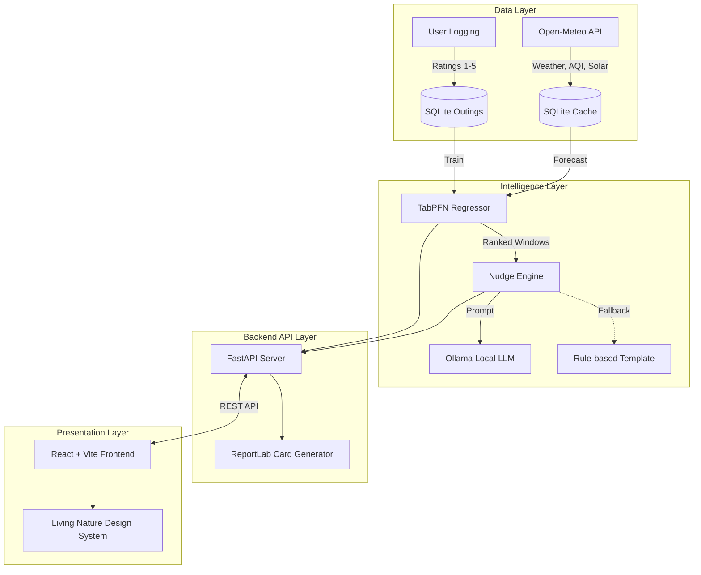

# 🌿 Grassday

*A local-first open-source AI companion that predicts your perfect outdoor window, generating a beautiful field card and a nudge to step away from your screen.*

**Built for DEV Hacktoberfest Open-Source AI Challenge - "Touch Grass" Theme.** 

Grassday minimizes your screen time by finding the best moments to "touch grass" based on your actual historical preferences, weather, and air quality. It learns locally via [TabPFN](https://github.com/automl/TabPFN), generates offline context-aware nudges via [Ollama](https://github.com/ollama/ollama), and produces a printable PDF field card so you can leave your phone behind. The "Living Nature" UI design is intentionally minimal—giving you the answer in one glance so the screen is the shortest part of your outdoor experience.

---

## 📸 Screenshots

*(Insert screenshots here: Hero Recommendation Card, the 7-day forecast strip, and the generated PDF field card)*

---

## 🚀 Installation & Running

### Requirements
- **Python 3.11+**
- **Node.js 18+** (for the frontend)
- **Ollama** installed locally (optional, but recommended for natural language nudges).
- Dependencies are pinned in `requirements.txt` and `package.json`.

### Quick Start
1. Clone the repository and navigate to the directory:
   ```bash
   git clone https://github.com/yourusername/grassday.git
   cd grassday
   ```
2. Install Python backend dependencies:
   ```bash
   pip install -r requirements.txt
   ```
3. Install Node frontend dependencies:
   ```bash
   cd frontend
   npm install
   cd ..
   ```
4. Start the FastAPI backend:
   ```bash
   python -m uvicorn api:app --host 127.0.0.1 --port 8000
   ```
5. In a new terminal, start the React frontend:
   ```bash
   cd frontend
   npm run dev
   ```
   *Visit `http://localhost:5173` in your browser.*

### 🎬 Demo Mode (Offline / Judge Experience)
To instantly test the app without spending weeks logging data, run the backend with the `--demo` flag. This seeds your local SQLite database with 25 realistic outings, exhibiting a user who secretly prefers 18–24°C, low wind, and no rain.
- **Backend Demo**: `python -m uvicorn api:app --host 127.0.0.1 --port 8000` (Note: In `api.py`, set `DEMO_MODE = True` or run `python demo.py` to seed the database).
*(Demo mode also utilizes a pre-bundled static forecast JSON, ensuring it works entirely without a network connection).*

---

## 🧠 How the Model Learns

Grassday doesn't just guess; it fits a local TabPFN regression model mapping 14 environmental features (temperature, UV, daylight fraction, sunset proximity, PM2.5, etc.) to your subjective 1-5 rating.

*But does it actually work?* 
Using **Leave-One-Out Cross-Validation (LOOCV)** on 25 synthetic outings with complex, nonlinear user preferences:
- **Naive Baseline MAE** (predicting the average rating): `0.92`
- **Grassday TabPFN MAE**: `0.82`
- **Improvement:** `11.4%` reduction in absolute error with only 25 data points!

### The Cold Start Problem
If you have fewer than 10 outings logged, Grassday gracefully blends TabPFN with a **transparent biometeorological heuristic prior** (penalizing high UV, extreme winds, etc.), ensuring predictions are sensible from day one.

---

## 🏛️ Architecture



---

## 🌍 Deployment (Public Demo)

You can deploy the backend to Render or DigitalOcean, and the frontend to Vercel or Netlify. Because hosted free tiers cannot run Ollama, the app gracefully falls back to a rule-based template engine for text nudges when deployed publicly.

*Note: The public hosted demo uses seeded demo data. To get real personalization, run the app locally.*

### Render Deployment (Backend)
1. Fork this repo and connect it to a new Render Web Service.
2. Build Command: `pip install -r requirements.txt`
3. Start Command: `uvicorn api:app --host 0.0.0.0 --port 10000 --demo`
4. Set Environment Variables: `DEMO_MODE=True`

### Docker Deployment
A `Dockerfile` is included to build and run both the backend and compiled frontend instantly:
```bash
docker build -t grassday .
docker run -p 8000:8000 grassday
```

## 🛠️ Quick Commands (Makefile)
If you prefer `make`, the repository includes a Makefile for fast local development:
- `make setup`: Installs all backend and frontend dependencies.
- `make demo`: Runs the backend with the offline demo data seeded.
- `make frontend`: Starts the React dev server.
- `make test`: Runs the pytest suite.

---

## 🔓 Why Open-Source AI?

1. **Absolute Privacy:** Your location, routines, and preferences never leave your machine. The models (TabPFN and Ollama) execute entirely locally.
2. **Offline Resilience:** With the forecast cached, the app and models run perfectly in the woods without cell service.
3. **Zero Cost:** No API keys, no subscription fees for proprietary LLMs.
4. **Swap-able Models:** Want to use `llama3.2` instead of `qwen3`? Just pull it via Ollama and update `.env`. 

*Limitation:* The initial TabPFN weights (~100MB) take a few seconds to download on the very first run, and running an LLM requires ~4GB of RAM.

---

## ⚖️ Open-Source AI Licensing

Grassday relies heavily on open-weights and open-source models:
1. **TabPFN:** The pre-trained neural network used for tabular prediction requires accepting its research license to download weights. Grassday downloads these weights automatically (~100MB) and caches them locally on first run.
2. **Local LLMs:** All LLM generation relies on local instances via Ollama (e.g. using open-weight models like `llama3.2`, `qwen3`, or `mistral`). You must have Ollama installed and a model pulled (`ollama pull qwen3`). Your outing data and preferences never leave your machine.
