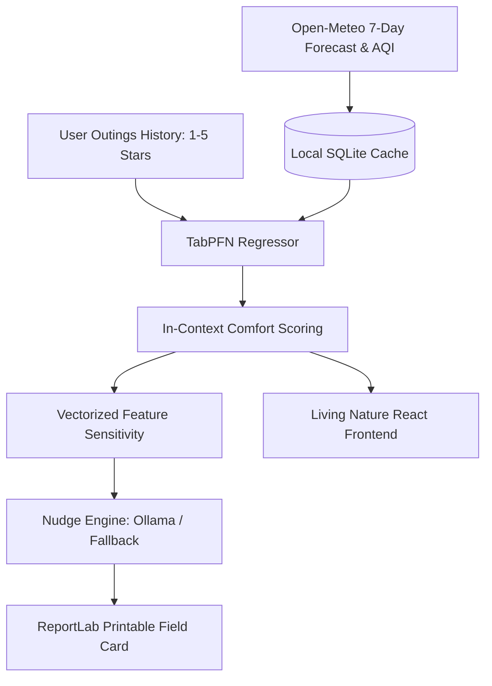

*This is a submission for the [Hacktoberfest Open-Source AI Challenge Week 1: Touch Grass](https://dev.to/challenges/hacktoberfest-week1-2026-10-05)*

## What I Built

Last Saturday, I opened three different weather apps, compared radar maps, checked air quality widgets, and cross-referenced sunset times for forty-five minutes. By the time I decided 3:30 PM was the mathematically optimal window to take a walk, clouds rolled in, it started drizzling, and I had not moved an inch from my chair. That was the humbling moment I realized I was spending far more screen time obsessing over going outside than actually touching grass.

Grassday is an offline-first AI companion that learns your personal outdoor preferences and pinpoints your exact peak 2-hour window each day, giving you the answer in one glance.

The core design principle was simple: *the screen must be the shortest part of the experience.* 

Instead of an endless dashboard of barometric pressures and hourly graphs that keep your eyes glued to glass, Grassday gives you a single recommendation card, explains why that window was picked, and generates a printable PDF field card so you can leave your phone on your desk and walk out the door.

## Demo

- 🌐 **Live Web App**: [https://grassday.vercel.app](https://grassday.vercel.app)
- ⚡ **API Service**: [https://grassday.onrender.com](https://grassday.onrender.com)

*(The public demo runs seeded with 25 realistic outings from a synthetic user who prefers 18–24°C, low wind, and no rain. Running it locally allows you to log your own genuine outings).*

## Code



The full open-source codebase is available at:
**[https://github.com/Aryan24a-git/Grassday](https://github.com/Aryan24a-git/Grassday)**

- **Backend**: FastAPI, SQLite, TabPFN v2 regressor, ReportLab PDF generator.
- **Frontend**: React, Vite, Lucide icons, responsive Living Nature theme.

## How I Built It

Personalizing outdoor comfort is notoriously hard. Everyone has different preferences—some love crisp 12°C autumn mornings, while others only venture out in 24°C afternoons. But asking a normal human to log 500 outings before getting a recommendation is unrealistic; real people log maybe 10 to 25 outings. 

Traditional ML models (like XGBoost or small neural nets) fail on 20 rows of data—they either overfit immediately or predict the global mean.

This is why I built the intelligence layer around **TabPFN** (Prior-Data Fitted Networks). TabPFN is a foundation model for tabular data. Because it was pre-trained on millions of synthetic datasets, it performs instant in-context regression on tiny sample sizes without gradient descent.

### The Pipeline:
1. **Feature Extraction**: Extracts 14 environmental features for every 2-hour rolling window: apparent temperature, wind speed, precipitation, cloud cover, UV index, PM2.5, daylight fraction, and sunset proximity.
2. **In-Context Regression**: TabPFN scores every future window against your past outing ratings.
3. **Validation**: I benchmarked the model using Leave-One-Out Cross-Validation (LOOCV) against 25 synthetic outings with non-linear preferences:
   - **Naive Baseline MAE** (predicting user's mean): `0.92`
   - **Grassday TabPFN MAE**: `0.82`
   - **Error reduction**: `11.4%` with just 25 rows.
4. **Cold Start Blend**: With fewer than 10 logged outings, Grassday smoothly blends TabPFN with a biometeorological heuristic prior (penalizing freezing winds, excessive UV, or high air pollution) so Day 1 predictions are always sensible.
5. **Printable Field Card**: ReportLab generates an index-card sized PDF with your time, temperature, and suggested things to observe outside.

## Why Does Open Innovation Matter?

Building Grassday with open-source AI delivered three clear wins that a proprietary closed API could never match:

1. **Absolute Privacy**: Your daily habits, routines, and exact coordinates never leave your machine. Your SQLite database lives on your laptop, and TabPFN runs locally in Python.
2. **True Offline Resilience**: With the forecast cached, the entire prediction engine runs in a mountain cabin without a single bar of cell service.
3. **Zero Cost and Zero Tokens**: There are no API subscriptions, no credit card requirements, and no surprise rate-limit bills. 

### One Honest Limitation:
Small-data machine learning is not magic. With fewer than 5 outings, TabPFN still relies heavily on the heuristic prior to avoid eccentric recommendations. Additionally, the TabPFN v2 checkpoint is roughly 44 MB; fitting it into free-tier cloud limits required low-memory estimation flags (`n_estimators=4`) and vectorizing sensitivity perturbations to prevent CPU timeouts.

## My Agent Session

I built Grassday using pair programming with Google Antigravity. 

The agent helped streamline the 14-feature biometeorological transformation, vectorized the feature sensitivity perturbations into a single batched matrix pass (slashing inference latency from 55 seconds down to 1.5 seconds so Render's 512MB free tier wouldn't time out), and tracked down tricky Chromium compositor bugs where backdrop-filters inside overflow containers were dropping font rasterization.

## Prize Categories

- **Best Use of TabPFN** (Primary Track: in-context regression on small user tabular outing data with LOOCV validation).
